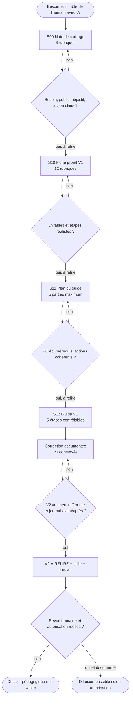

# Organigramme de l'exemple S09–S12

Ce schéma décrit la progression pédagogique, non une application automatique capable de valider des contenus.

## Algorithme opérationnel

**Début →** choisir un besoin non confidentiel ; classer le cas comme fictif ; créer les dossiers 00–08.

**S09 →** décrire les six rubriques ; relire ; exporter une note V1 ; conserver la trace.

**S10 →** importer la note ; préciser les douze rubriques ; écrire « À vérifier » si nécessaire ; exporter fiche V1 et preuve.

**S11 →** importer note et fiche ; structurer cinq parties maximum ; prévoir checklist et priorité S12 ; exporter plan V1.

**S12 V1 →** importer le plan ; décrire au moins trois procédures avec résultat observé ; rédiger erreurs, checklist et points à vérifier ; conserver V1.

**S12 V2 →** modifier réellement la V1, décrire chaque changement et son motif ; vérifier le diff ; exporter la V2 **sans la déclarer validée**.

**Clôture →** classer prompts, grilles, preuves et bilan ; revue humaine explicite avant tout partage réel ; ne jamais publier les archives privées.

## Exemple de porte de contrôle

**Question :** « Peut-on diffuser un guide dont une affirmation importante n'a pas de source ? »  
**Non.** Marquer « À vérifier », suspendre la diffusion, rechercher une source compétente ou supprimer l'affirmation.
